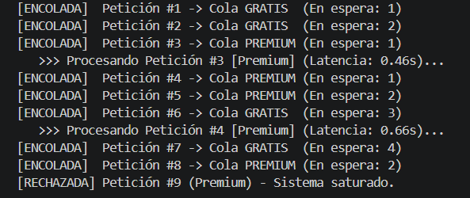
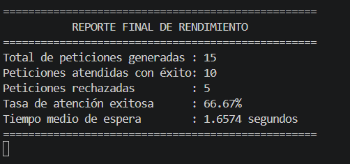
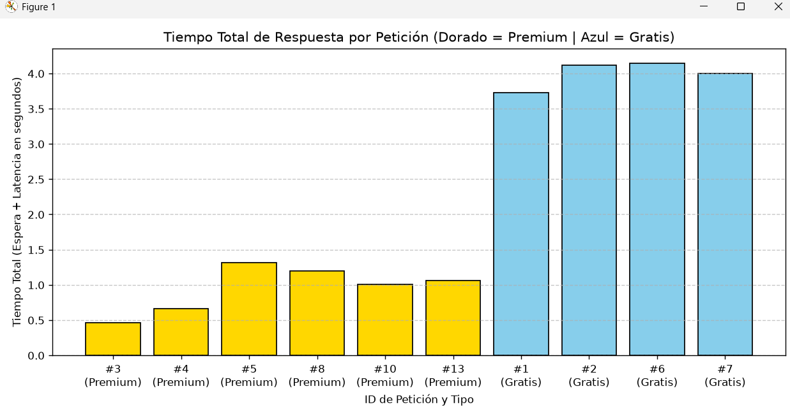

# Manual de Usuario - Simulador de Colas y Balanceo de Carga

## 1. Introducción
Este programa permite visualizar de forma práctica cómo un servidor organiza y atiende peticiones de usuarios con distintos niveles de prioridad (**Premium** y **Gratuitos**), evitando el colapso del sistema cuando hay exceso de tráfico.

## 2. Flujo de Uso Paso a Paso

### Paso 1: Inicio de la simulación y monitoreo de colas
Al ejecutar el programa en la consola, el sistema genera peticiones entrantes y las clasifica en tiempo real:
* **[ENCOLADA]:** La solicitud ingresó correctamente a la cola `PREMIUM` o `GRATIS`.
* **[RECHAZADA]:** El sistema alcanzó su límite máximo de capacidad y descartó la petición para evitar bloqueos.
* **[>>> Procesando]:** El servidor atiende siempre primero las peticiones de la cola `PREMIUM` antes de pasar a la cola `GRATIS`.

### Paso 2: Lectura del Reporte Final
Al terminar de procesar todas las solicitudes, la consola muestra un resumen con las métricas clave:
* **Total de peticiones generadas** y **atendidas con éxito**.
* **Peticiones rechazadas** por saturación.
* **Tasa de atención exitosa (%)**.
* **Tiempo medio de espera (segundos)**.

### Paso 3: Visualización Gráfica
Inmediatamente después del reporte, se abrirá una ventana emergente con un gráfico de barras:
* **Barras doradas:** Peticiones de usuarios **Premium** (tiempos de respuesta más cortos).
* **Barras azules:** Peticiones de usuarios **Gratuitos** (tiempos mayores debido a la espera por prioridad).

