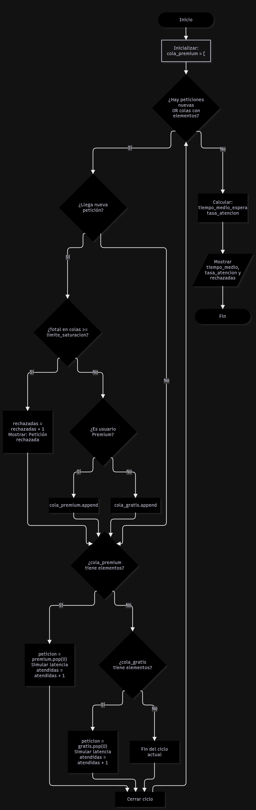

# Manual Técnico y de Arquitectura

## 1. Arquitectura del Sistema
El software sigue un **enfoque procedural modular**, diseñado específicamente con fines académicos para demostrar la teoría de colas sin dependencias de frameworks web o APIs externas.

El sistema se divide en cuatro módulos lógicos dentro de `main.py`:
1. **Inicialización y Estado:** Definición de las estructuras en memoria (`cola_premium` y `cola_gratis`) y contadores de métricas.
2. **Generador de Carga:** Función `generar_peticiones()` que crea objetos tipo diccionario con `id`, `tipo` y marca de tiempo (`timestamp`).
3. **Motor de Balanceo y Procesamiento:** Bucle principal `ejecutar_simulacion()` que evalúa la saturación, encola solicitudes y despacha por prioridad estricta.
4. **Módulo de Analítica y Visualización:** Cálculo estadístico final y renderizado de barras mediante `generar_grafica()` con Matplotlib.

## 2. Estructuras de Datos y Algoritmos
* **Política FIFO (First-In, First-Out):** Se emplean listas nativas de Python utilizando `.append()` para insertar al final de la fila y `.pop(0)` para extraer siempre el elemento más antiguo.
* **Prioridad Estricta (Non-Preemptive):** El servidor verifica si `len(cola_premium) > 0` en cada iteración. Solo cuando la cola de alta prioridad está completamente vacía se extrae un elemento de `cola_gratis`.
* **Simulación de Latencia:** Se utiliza `time.sleep()` con valores pseudoaleatorios (`random.uniform`) para emular el costo computacional de procesar cada solicitud.

## 3. Diagrama de Flujo Lógico

